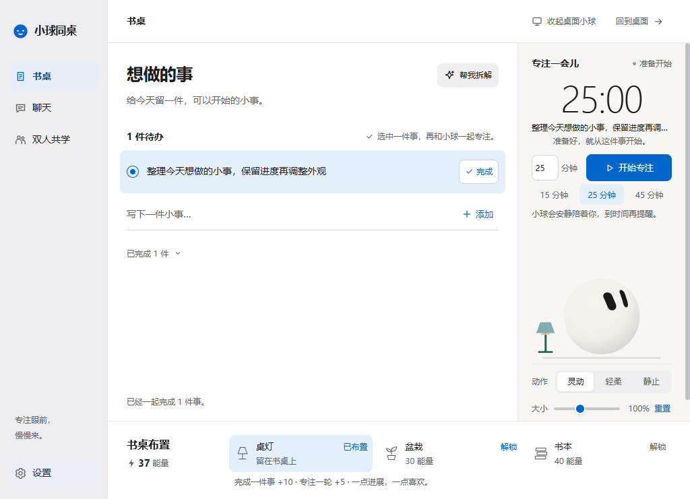
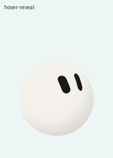
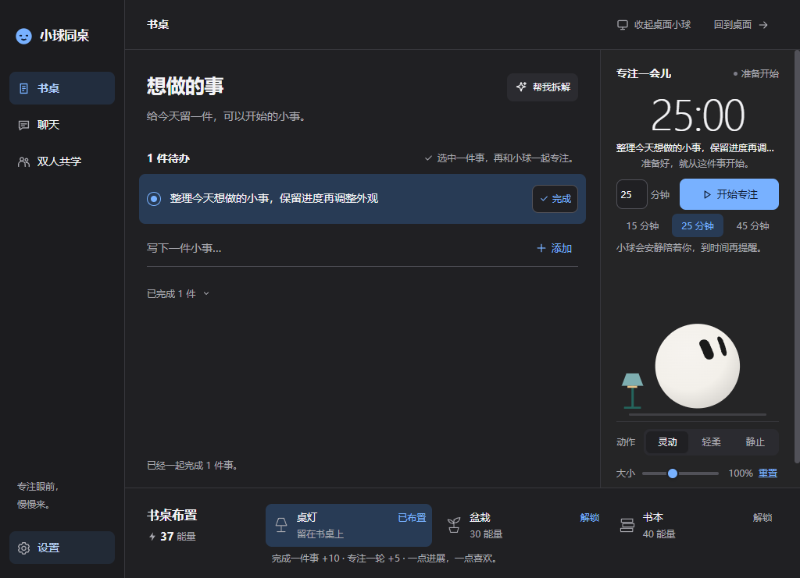
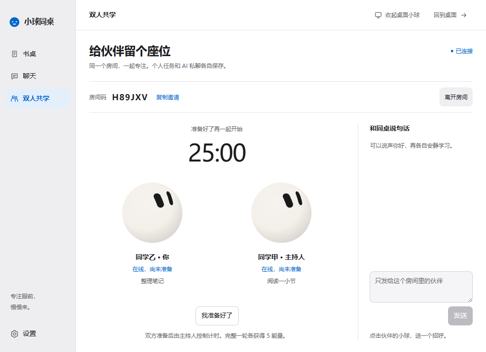

# 小球同桌 · Ball Buddy

一个有表情、会互动的 Windows 桌面学习伙伴。写下任务、专注一会儿、完成后撒花；也可以连接自己的 AI，拆开学习目标，邀请同学一起专注。

当前版本 **0.3.0**。采用侧栏、连续内容面和浅色 / 深色 / 跟随系统主题。基础任务、计时和桌宠离线可用，无应用账号、遥测或内置订阅。

**Windows 下载：[最新便携版](https://github.com/aci825223-ai/ball-buddy/releases/latest)。**下载 `BallBuddy-0.3.0-windows-x64.zip`，解压完整文件夹后双击 `BallBuddy.exe`；桌面应用不需要另装 Node.js。请保留其他运行时文件，不要只取出 EXE。当前提供便携版，尚无安装器或代码签名；独立共学服务仍需 Node.js。

> **角色与动画署名：**本项目使用 [sam70361](https://github.com/sam70361) 的 [EmotionBall](https://github.com/sam70361/emotion-ball)，固定来源为 [aora-bot](https://github.com/sam70361/aora-bot) 的提交 `e3b6148c818da4a8e1966f2bc89cdb3cee473b73`。原创应用代码采用 MIT；EmotionBall 保留 **非商业社区许可**，球形角色视觉禁止商业用途。整个仓库并非统一 MIT，详见 [许可与来源](#许可与来源)。



## 能做什么

| 功能 | 当前行为 |
| --- | --- |
| 实时桌宠 | 连续呼吸、眨眼、形变与缓慢变色；鼠标靠近时眼神跟随，单击弹跳，双击旋转彩带，拖动放手回弹 |
| 任务与专注 | 本地任务、完成记录；1–180 分钟计时、暂停、继续和重启恢复；默认 25 分钟 |
| 能量与布置 | 完成任务 +10，完整专注 +5；用能量解锁桌灯、盆栽和书本 |
| 外观与窗口 | 浅色 / 深色 / 系统主题；字体导入、三档文字大小；桌宠 70%–150% 缩放、动作、置顶、托盘与关闭行为 |
| 自选 AI | 多服务 / 多模型配置，流式聊天、停止、复制、历史与重试；支持三类文本 API 协议 |
| 任务拆解 | AI 生成建议步骤，自己编辑、勾选后确认加入任务 |
| 双人共学 | 自建服务、房间码加入、共同计时、文字消息与伙伴招呼；服务端权威计时和奖励去重 |

桌宠默认只显示球体；鼠标经过时说话气泡和操作条出现，移开后收起。键盘 Tab 也能显示控件。灵动、轻柔、静止三种动作可选，隐藏或离屏时停帧。



<details>
<summary>查看深色主题与双人共学</summary>





</details>

展示内容来自隔离测试数据；首次运行没有预置任务。GIF 来自实际运行采样，采样间隔不代表渲染帧率。

## 从源码运行

已验证平台为 Windows。安装 [Node.js](https://nodejs.org/) **22.12.0 或以上**与 npm，下载或克隆本仓库，进入项目根目录后执行：

```powershell
npm ci
npm start
```

依赖只安装在本项目中，不需要全局包。首次安装需要联网下载 Electron。任务、偏好和聊天保存在应用自己的本机数据目录中，更新源码或重新打包不会将它们写进仓库。

要运行共学服务、服务测试或生成包含服务的便携包，再安装独立服务依赖：

```powershell
npm --prefix server ci
```

### 打包 Windows 便携版

```powershell
npm run package
```

输出在 `dist/`，具体目录由 `artifacts/package.json` 记录。双击输出目录中的 `BallBuddy.exe`，保留整个文件夹；不要只移动一个 EXE。包内 `study-server/` 是独立共学服务，运行它仍需 Node.js。

当前未提供安装器或代码签名，也未验证 macOS / Linux 桌面端。

## 使用自己的 AI

打开「设置 → AI 连接」，填写服务名称、协议、API 地址、API 密钥与模型 ID，保存后在聊天页选择该连接。可以保存多个厂商，也可以连接本机兼容服务。预设只是配置快捷方式，具体模型需支持所选协议的文本能力。

| 协议 | 对应接口类型 |
| --- | --- |
| OpenAI 兼容 | Chat Completions 文本与流式输出 |
| Claude | Messages 文本与流式输出 |
| Gemini | 文本生成与流式输出 |

模型 ID 可手填，或主动读取服务提供的模型列表。「已保存」只表示配置保存成功；「测试连接」才会向服务发请求。仅在你发送、拆解、读取模型或测试时调用服务，API 费用和数据处理规则由所选厂商决定。

聊天中可停止输出、复制文字、查看历史和重试；重启保留已收到的文本，中断请求不会自动重发。「帮我拆解」可填写目标与可用时间，修改步骤并勾选后再加入任务。AI 输出只作为文字和建议，不自动运行代码或完成任务。

## 双人共学

仓库包含共学服务源码，**没有默认公共服务器**。本机启动服务：

```powershell
npm --prefix server ci
npm --prefix server start -- --host 127.0.0.1 --port 8787
```

两个客户端在「双人共学」填写同一个服务地址 `ws://127.0.0.1:8787/study`。一人创建房间，将六位房间码告诉另一人；双方准备后由主持人开始、暂停、继续或结束。

不同网络需在双方都可访问的服务器运行服务，通过 TLS 反向代理提供 `wss://你的域名/study`。**房间码不能代替可达服务器或网络穿透。**部署与数据保管说明见 [server/README.md](server/README.md)。

共学最多两人；断线暂停，重连后重新准备再继续。个人专注与共学轮次互斥，完整共学每人 +5 能量，重复回执不会重复发奖。个人任务仍由自己完成。

## 设置与数据

「设置」包含外观、窗口、桌宠、专注和 AI 连接五组。外观等偏好自动保存；AI 连接需点击保存。可导入 TTF / OTF / WOFF / WOFF2 字体（单个至多 32 MiB），实际解码成功后复制到应用数据目录，无需安装系统字体。

关闭主面板可设为隐藏到右下角托盘或彻底退出；托盘菜单「退出小球同桌」始终彻底退出。「回到桌面」只隐藏主面板。恢复默认设置保留任务、奖励、布置和已导入字体文件。

- 任务与偏好保存在 Electron `userData` 下的 `state.json` 和备份；AI 会话与共学状态独立存储。
- API 密钥与重连凭据使用 Electron `safeStorage` 加密；加密不可用时密钥仅当次使用，并显示提示。聊天和任务文本并非整体加密，请按个人数据保管应用目录。
- 不自动读取其他应用、键盘、摄像头、麦克风或桌面内容。桌宠可见且非静止时，为近距注视最多每秒读取 25 次鼠标坐标，不记录轨迹，隐藏与退出停止。
- 共学只同步昵称、你填写的学习目标、房间状态、消息与招呼；个人任务列表、AI 私聊和密钥不发送给伙伴或共学服务。
- 聊天仅在主动发送时请求所选 AI；附带选中任务需由你主动选择。共学聊天不会自动送给 AI。

## 开发与验证

```powershell
npm run check
npm test
npm run server-test
```

以上分别检查语法与资源边界、核心状态 / 持久化 / AI 客户端、独立共学协议。服务测试需要先执行 `npm --prefix server ci`。

真实 Electron 验收脚本包括 `npm run smoke`、`npm run theme-smoke`；包版设置与 AI / 共学验收为 `npm run settings-smoke -- --packaged` 和 `npm run ai-study-smoke -- --packaged`。GIF 生成需已有 Python / Pillow，可通过 `BALL_BUDDY_PYTHON` 指定 Python 路径。更多说明见 [CONTRIBUTING.md](CONTRIBUTING.md) 和 [docs/VALIDATION.md](docs/VALIDATION.md)。验收数据写入 `artifacts/` 的隔离目录，不使用个人应用记录；部分互动脚本会短暂移动系统鼠标，应顺序运行并让鼠标闲置。`theme-audit` / `theme-finalize` / `theme-upgrade` 脚本依赖维护者本机旧包和恢复存档，不是新克隆仓库的必跑检查。

0.3.0 已通过 69 项核心测试、7 项服务测试及真实 Electron 主题、设置、桌宠、AI / 两客户端共学验收。AI 协议验证使用本地 HTTP / SSE fixture；共学使用本机服务与两个真实客户端。**尚未实测真实厂商 API 或跨公网连接**，也未验证屏幕阅读器、多显示器切换和其他显示缩放比例。

## 仓库结构

```text
.
├── src/
│   ├── main/              # Electron 窗口、IPC、本地保存、AI 与共学客户端
│   ├── shared/            # 任务、计时、奖励与输入校验
│   └── renderer/          # 主面板、桌宠和动画适配层
├── server/                # 独立 Node.js / WebSocket 共学服务
├── tests/                 # 核心与客户端测试
├── scripts/               # 检查、验收和打包工具
├── vendor/emotion-ball/   # 固定版本上游源码与完整原始授权
├── docs/                  # 项目总结、设计、协议、验证与公开图片
├── .github/               # Issue 和 Pull Request 模板
├── AGENTS.md              # 项目工程规则
├── LICENSE                # 原创代码 MIT 范围与混合许可说明
└── NOTICE.md              # 上游署名与授权边界
```

`node_modules/`、`dist/`、`artifacts/`、服务运行数据、字体和凭据不提交。项目交接与关键决策见 [docs/PROJECT_SUMMARY.md](docs/PROJECT_SUMMARY.md)，版本变化见 [CHANGELOG.md](CHANGELOG.md)。

## 许可与来源

Ball Buddy 的原创应用代码采用 [MIT](LICENSE)。以下内容保留各自许可，MIT 不替代它们：

- **EmotionBall 作者：[sam70361](https://github.com/sam70361)。**原项目链接为 [sam70361/emotion-ball](https://github.com/sam70361/emotion-ball)，收录来源为 [sam70361/aora-bot](https://github.com/sam70361/aora-bot)，固定提交 [`e3b6148`](https://github.com/sam70361/aora-bot/tree/e3b6148c818da4a8e1966f2bc89cdb3cee473b73)。
- 原始 `rings.js`、`emotions.js`、`ball.js`、`engine.js` 原样收录于 `vendor/emotion-ball/`；本项目互动与宿主适配位于 `src/renderer/companion.js`。
- 上游使用 **Emotion Ball Community License**，允许署名的非商业学习、研究与技术交流。引擎 / 表情数据的商业使用需另行取得商业授权；**球形角色视觉禁止任何商业用途，且上游不提供其商业许可**。分发衍生作品必须保留完整许可、版权与 NOTICE。
- 完整依据见 [上游 LICENSE](vendor/emotion-ball/LICENSE)、[上游 NOTICE](vendor/emotion-ball/NOTICE.md)、[商业授权说明](vendor/emotion-ball/LICENSE-COMMERCIAL.md) 与 [来源记录](vendor/emotion-ball/SOURCE.md)。仓库截图中的角色也受同一限制。

这个仓库公开提供全部项目源码，采用混合许可；包含当前球形角色的完整应用不能作为无商业限制的软件使用或发布。贡献说明见 [CONTRIBUTING.md](CONTRIBUTING.md)，安全报告方式见 [SECURITY.md](SECURITY.md)。
