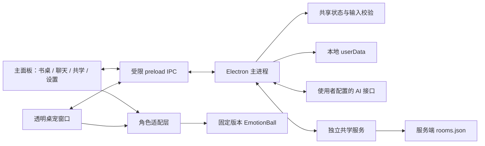

# 架构与数据流

桌面业务由 Electron 主进程统一管理。主面板和透明桌宠窗口展示同一份状态；独立共学服务管理两人房间及共同计时，不访问个人任务或 AI 数据。

## 模块职责

| 位置 | 职责 |
| --- | --- |
| `src/main/main.cjs` | 单实例、两窗、托盘、主题与置顶、IPC 调用者校验、保存后广播、AI/共学集成 |
| `src/main/preload.cjs` | 暴露固定 `window.buddy` 方法和有限事件，不提供任意文件或网络接口 |
| `src/main/storage.cjs` | 业务 JSON 原子替换、有效备份与坏记录恢复副本 |
| `src/main/fonts.cjs` | 原生选字框候选、格式与大小校验、内容哈希副本及受限读取 |
| `src/main/ai-service.cjs`、`ai-providers.cjs`、`ai-storage.cjs` | 多连接、凭据、请求生命周期、三类协议、流式解析、脱敏、聊天持久化和拆解 |
| `src/main/study-client.cjs` | 连接与重连、加密身份、房间快照、待结算回执和本地恢复 |
| `src/shared/state.cjs` | 纯业务状态规则、命令、时间戳协调、输入校验及奖励去重 |
| `src/shared/ai-validation.cjs`、`study-protocol.cjs` | AI 配置和共学消息的共用格式边界 |
| `src/renderer/` | 页面、表单、主题和字体应用、交互、单个主球实例与桌宠适配 |
| `server/src/index.cjs`、`protocol.cjs` | 房间服务、身份/主持权限、权威共同计时、操作限频、回执与恢复 |
| `tests/`、`server/tests/` | 内置 Node.js 测试；不依赖私人记录 |
| `scripts/` | 检查、打包、真实 Electron 烟测；报告写入隔离目录 |
| `vendor/emotion-ball/` | 原样上游文件、原许可和固定来源 |

## 本地状态与文件

应用以 Electron 的 `app.getPath('userData')` 为运行数据根目录。Windows 通常位于当前用户 AppData 下；不要依赖源码目录或便携 EXE 的相邻目录推断实际记录位置。测试进程通过专用 smoke 配置使用 `artifacts/` 中的隔离目录。

| 相对 `userData` 的文件 | 内容与处理 |
| --- | --- |
| `state.json` | 版本 1 的任务、选择、个人 session、统计、布置、设置、活动及去重标记 |
| `state.backup.json` | 上一次有效业务记录；坏主文件不会覆盖有效备份 |
| `state.recovery-*.json` | 主记录损坏时尽可能保留的原文件副本，不自动清理 |
| `fonts/<sha256>.<ext>` | 经校验、实际 `FontFace` 解码后采用的字体副本；不修改系统字体 |
| `ai/config.json` | 连接元信息与可用时的加密 API 密钥；返回渲染层的配置只有 `hasKey` 等脱敏字段 |
| `ai/chats/<uuid>.json` | 会话文字、状态和连接引用；保存备份、中断草稿与归档状态 |
| `study/config.json` | 服务地址和昵称 |
| `study/identity.json` | 可用时加密保存的房间重连身份，未加密时凭据只存在内存 |
| `study/receipts.json` | 已认证、尚未完整提交的终态回执，支持离线恢复；不含重连密钥 |

AI 文件还有相应 `.backup` 和异常恢复文件。共学服务在指定数据目录使用 `rooms.json` 及 `.previous` 备份，保存房间状态、消息和重连密钥的 SHA-256 摘要。文字记录和备份仍属于使用者数据；不要加入源码仓库或公开问题附件。

## 业务提交

1. 渲染层调用固定桥的方法或发送支持的业务命令。
2. 主进程验证窗口/主 frame、命令和输入；共享模块返回下一状态与效果。
3. 主进程将下一状态保存成功，再替换内存状态、应用原生偏好并广播两窗。
4. 界面显示保存失败，已存业务值不被未保存的新值替换。

业务 `version` 保持 1。归一化补默认值并保留未知字段；恢复默认只处理明确偏好，不清空任务、奖励、布置或字体文件。计时通过 `endAt` 和 `remainingMs` 计算，心跳用于协调而非作为准确计时来源。

## AI 请求

保存连接配置本身不联网。使用者主动测试、读取模型、发送聊天或拆解时，主进程才使用所选地址和协议发请求。请求返回标识后，以 `started/delta/finished/stopped/error/plan` 事件更新主面板，桌宠只收到有限忙碌/互动状态。

文字按普通内容显示，流式解码处理分块、结束、取消、超时和中断。拆解经结构校验为最多 12 步；渲染层允许编辑与选择，最终通过 `task.batch-add` 原子加入并记录计划去重。聊天不会默认发送全部任务，也不会读取共学聊天。

## 共学计时与结算

服务端限定两人，校验房间身份、主持权限及准备状态。共同计时与个人计时互斥；断线、暂停和服务恢复有明确状态，界面按服务快照及连接状态展示。

终态提交顺序：认证连接收到回执 → 校验成员身份 → 保存本地待提交回执 → 同一次保存业务统计与 `roomId/roundId/memberId` 去重键 → 移除本地待提交项 → 向同身份服务连接确认。任何一步失败均不能提前确认服务端。重启时可恢复已落盘回执，不自动打开连接。

服务端正常关闭保存当前有效时间，运行中每 5 秒检查点。异常崩溃恢复只计最后成功检查点之前的有效时间，不计停机时间。完成共同轮次奖励 5 能量，提前结束只统计有效时间。

## 窗口、动画与信任边界

- 两窗启用隔离与沙箱，关闭 Node 集成，阻止外部导航；页面 CSP 禁止直接网络连接。
- 字体导入仅接受主进程对话框产生的候选和受限 ID；支持四种格式，最大 32 MiB，实际解码成功才确认选择。
- 桌宠鼠标坐标只在可见且非静止时至多 25 Hz 采样，不持久化、不监听全局点击或键盘。
- 动画逻辑在宿主层扩展，隐藏与静止冻结。桌宠通过 CSS 整组缩放并同步原生尺寸；页面切换移动一个主球实例，避免重复实例。
- AI 密钥和房间重连身份仅由主进程解密；系统加密不可用时采用本次运行内存凭据。
- 这是桌面应用与房间服务的现有边界说明，不代表已经完成所有平台或第三方安全认证。

## 验证分层

`npm test` 与 `npm run server-test` 验状态和协议；`npm run check` 验语法/资源边界；真实 Electron 脚本验窗口、连续动画、实际交互、设置和两客户端。外部厂商请求、公网环境、系统托盘外壳、真实通知展示等，需要单独的相应环境证据。静态截图不能证明动画连贯，也不能把本机 fixture 结果写为厂商或公网实测。

相关规则见 [AGENTS.md](../AGENTS.md)，协议合同见 [AI-STUDY-CONTRACT.md](AI-STUDY-CONTRACT.md)，真实结果见 [VALIDATION.md](VALIDATION.md)。EmotionBall 来源与限制见 [PROJECT_SUMMARY.md](PROJECT_SUMMARY.md#授权与来源)。
